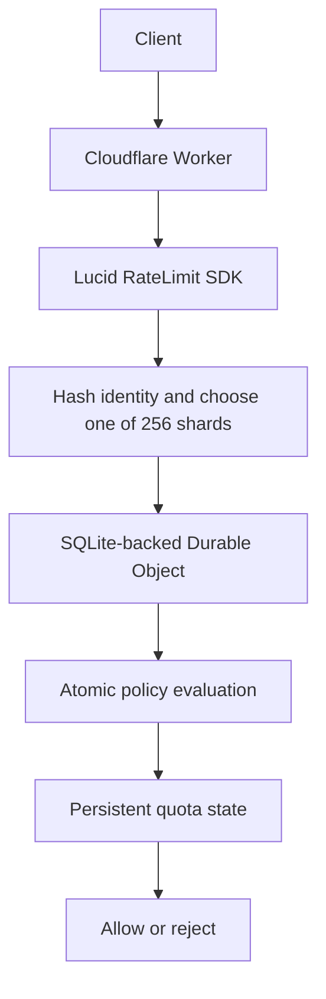

# Lucid RateLimit

**Distributed rate limiting for Cloudflare Workers, coordinated by Durable Objects.**


Lucid RateLimit provides atomic, persistent rate-limit decisions at the edge. The core package has no runtime dependencies; the optional middleware package adds vanilla Worker and Hono adapters.

## Status

This repository is prepared for an initial release, but it has not been published or deployed. The npm registry currently returns 404 for `@lucid/ratelimit`; that means no public package/version was found, and does not reserve the name or prove that the `@lucid` scope is available to your account. Change the `name` fields and imports before release if needed.

## Install

```sh
npm install @lucid/ratelimit
```

For the optional middleware:

```sh
npm install @lucid/ratelimit-middleware
```

## Quick start

Export the Durable Object class from your Worker entry point and bind it in Wrangler:

```ts
// src/index.ts
import { RateLimit } from '@lucid/ratelimit';
import type { RateLimitDurableObject } from '@lucid/ratelimit/durable-object';

export { RateLimitDurableObject } from '@lucid/ratelimit/durable-object';

interface Env {
  RATE_LIMITER: DurableObjectNamespace<RateLimitDurableObject>;
}

export default {
  async fetch(request: Request, env: Env): Promise<Response> {
    const limiter = new RateLimit({
      namespace: env.RATE_LIMITER,
      algorithm: 'sliding-window',
      limit: 100,
      window: '1m',
      failureMode: 'closed',
    });

    const identity = `user:${await authenticatedUserId(request)}`;
    const result = await limiter.limit(identity);
    if (!result.success) {
      return new Response('Too many requests', { status: 429, headers: result.headers });
    }
    return new Response('OK', { headers: result.headers });
  },
};

async function authenticatedUserId(_request: Request): Promise<string> {
  // Replace with your authentication lookup.
  return '123';
}
```

```jsonc
// wrangler.jsonc
{
  "name": "my-worker",
  "main": "src/index.ts",
  "compatibility_date": "2026-11-13",
  "durable_objects": {
    "bindings": [{ "name": "RATE_LIMITER", "class_name": "RateLimitDurableObject" }],
  },
  "migrations": [{ "tag": "v1", "new_sqlite_classes": ["RateLimitDurableObject"] }],
}
```

The binding name and class name must match. For an existing deployment, add a new migration tag for each Durable Object class migration. See [examples/basic-worker](examples/basic-worker) for a runnable Worker.

## Algorithms

| Algorithm      | Configuration                              | Semantics                                                                                                                           |
| -------------- | ------------------------------------------ | ----------------------------------------------------------------------------------------------------------------------------------- |
| Fixed window   | `limit`, `window`                          | Epoch-aligned counter; fast and compact. Requests near a boundary can use nearly twice the configured limit in a short interval.    |
| Sliding window | `limit`, `window`                          | Exact rolling log of accepted weighted requests. At most 10,000 events per identity and policy; each decision reads the active log. |
| Token bucket   | `capacity`, `refillRate`, `refillInterval` | Refillable burst capacity. Tokens use integer micro-token storage and exact integer refill arithmetic.                              |

Durations are integer milliseconds or strings such as `"250ms"`, `"10s"`, `"5m"`, and `"1d"`. A duration must be between 1 millisecond and 30 days. Limits, capacities, refill rates, and request costs are positive integers no greater than 1,000,000. Sliding-window limits are capped at 10,000 to bound exact-log memory and work.

## Weighted requests

Cost is an integer quota unit. A request with cost 5 consumes five units only if all constraints accept it. A cost above any constraint's limit/capacity is permanently rejected with `cost_exceeds_limit` or `cost_exceeds_capacity`.

```ts
const result = await limiter.limit('user:123', { cost: 5 });
```

Fractional request costs are rejected. Token-bucket refill may be fractional internally; it is tracked at a precision of 1 micro-token (10⁻⁶ token), with integer remainder carried between decisions so refill rounding never creates quota.

## Named and composite policies

```ts
const limiter = new RateLimit({
  namespace: env.RATE_LIMITER,
  defaultPolicy: 'free',
  idempotencyRetention: '12h',
  policies: {
    free: { algorithm: 'sliding-window', limit: 100, window: '1m' },
    pro: { algorithm: 'token-bucket', capacity: 1_000, refillRate: 100, refillInterval: '1m' },
    api: {
      constraints: [
        { algorithm: 'fixed-window', limit: 10, window: '1s' },
        { algorithm: 'sliding-window', limit: 5_000, window: '1d' },
      ],
    },
  },
});

const result = await limiter.limit('tenant:acme', { policy: 'pro', cost: 5 });
```

One named policy is selected automatically if it is the only configured policy. With multiple policies, set `defaultPolicy` or pass `policy` to each call. A composite policy accepts one to eight independent constraints. They are evaluated and persisted by one Durable Object transaction, so a rejected call does not partially consume the constraints that would otherwise have passed.

Each policy name and normalized configuration version has a separate state key. Changing a policy configuration starts a new quota state; old rows expire under their original windows or idempotency retention. Keep policy names and `scope` stable across deployments. A deployment that runs old and new policy versions at once may temporarily enforce each version's state independently.

## Result and headers

```ts
interface RateLimitResult {
  success: boolean;
  enforced: boolean;
  degraded: boolean;
  limit: number;
  remaining: number;
  reset: number; // Unix epoch milliseconds
  retryAfter: number; // whole seconds; zero when allowed
  headers: Readonly<Record<string, string>>;
  policy?: string;
  reason?: string;
  failureCode?: 'durable_object_unavailable' | 'durable_object_storage';
  constraints?: readonly RateLimitConstraintResult[];
}
```

For a composite policy, top-level `limit`, `remaining`, and `reset` describe the most depleted successful constraint, or the limiting rejected constraint. `constraints` contains the per-constraint decisions. `RateLimit-Reset` is a delay in whole seconds until that constraint returns to full capacity; the `reset` property is the absolute Unix timestamp in milliseconds. For a rejected request, `Retry-After` is the time until its cost could fit; it is zero for a cost that exceeds a configured maximum permanently.

The SDK emits `RateLimit-Limit`, `RateLimit-Remaining`, and `RateLimit-Reset`; denied decisions also include `Retry-After`. Set `legacyHeaders: true` to add `X-RateLimit-*` compatibility headers. The library does not overwrite response headers when you use the middleware.

## Middleware

Vanilla Workers:

```ts
import { withRateLimit } from '@lucid/ratelimit-middleware';

const guarded = withRateLimit(
  limiter,
  {
    key: (request, env) => `user:${env.authenticatedUserId(request)}`,
    policy: (request) => (request.url.includes('/generate') ? 'pro' : 'free'),
    cost: (request) => (new URL(request.url).pathname === '/api/generate' ? 5 : 1),
  },
  async () => new Response('OK'),
);
```

`withRateLimit` returns a Worker-style `(request, env, executionContext) => Promise<Response>` handler. The key resolver is required: the package never silently trusts a user-provided identity header. Use `createRateLimitGuard` when a custom handler needs direct access to the decision. `honoRateLimit` is available from `@lucid/ratelimit-middleware/hono`; Hono is an optional peer dependency.

The middleware returns a JSON 429 by default. Supply `body` or `onRejected` to customize it. On allowed responses it adds the rate-limit headers. If identity resolution or cost resolution throws, the error propagates to the Worker; only Durable Object communication/storage failures follow `failureMode`.

For Lucid Analytics, use `onDecision` with a non-blocking queue adapter. [The example adapter](examples/lucid-analytics) forwards decision metadata and excludes identities; adapt its queue method to the client API available in your deployment. This package does not add an analytics dependency.

## Failure modes and retries

`failureMode` defaults to `"closed"`. If the Worker cannot obtain an authoritative result, the SDK returns `success: false`, `enforced: false`, `degraded: true`, and `reason: "rate_limit_unavailable"`, with a one-second `Retry-After`. Choose `"open"` only when allowing requests during a coordination outage is acceptable. In that mode, the SDK returns `success: true` but keeps `enforced: false`, `degraded: true`, and omits quota headers. `onError` receives a typed `RateLimitUnavailableError`; `onDecision` receives a structured event with no raw identity.

A successful decision is durable before the response is returned. If the client loses the response and retries without an idempotency key, the retry is a new attempt and can consume quota again. Provide the same stable `idempotencyKey` on a retry to return the original decision. Retention defaults to 24 hours and can be configured with `idempotencyRetention` (1ms–30 days). Keys are hashed before storage, capped at 128 UTF-8 bytes, and limited to 1,024 active records per identity.

## Architecture and operational bounds



The identity and scope are SHA-256 hashed in the Worker. The first digest byte chooses one of 256 deterministic Durable Object shards; the full digest is the private row owner key. A shard serializes storage decisions for its identities, which can add contention when traffic concentrates on one shard. Each shard has one cleanup alarm, not one alarm per identity. Storage caps are 20,000 active identities, 64 active policy states per identity, 250,000 sliding events, and 250,000 idempotency records per shard. A limit is checked inside the same transaction as the decision; reaching it fails through the configured failure mode. Sliding log capacity is also limited to 10,000 events per identity/policy.

The SQLite tables store only active fixed-window and token-bucket state, exact sliding events, and optional idempotency decisions. A shard alarm runs at the earliest expiry and deletes expired records. Durable Object restarts do not reset stored quotas. The stored per-shard clock is monotonic: if `Date.now()` moves backward, the shard clamps time to its last observed timestamp. A far-future clock jump can delay expiry for identities routed to that shard.

Durable Objects coordinate one logical bucket inside one DO; a composite policy is atomic because all its constraints are evaluated in that same object. There is no cross-object transaction and no promise of strict global multi-region consistency beyond Cloudflare's Durable Object routing model. The exact sliding log has O(n) read work in its active event count and O(n) retained events, with n capped at 10,000 per identity/policy. Fixed-window and token-bucket state use O(1) rows per policy constraint.

See [architecture and storage details](docs/architecture.md), [security notes](docs/security.md), [operations](docs/operations.md), and [release preparation](docs/release.md).

## Local development

Requirements: Node.js 20 or newer and npm.

```sh
npm install
npm run build
npm run typecheck
npm run lint
npm test
npm run bench
```

`npm test` runs unit and Worker-to-Durable-Object tests in Cloudflare's Vitest integration. `npm run bench` measures pure in-process algorithm cost under Node; it is not an end-to-end edge latency benchmark. A separate local Durable Object benchmark can be run with `npm run bench:do`.

## Cloudflare setup and deployment

1. Install the package and export `RateLimitDurableObject` from the Worker entry point.
2. Add a Durable Object binding and a `new_sqlite_classes` migration to `wrangler.jsonc`.
3. Keep the namespace binding, class name, `scope`, and policy names stable. Apply each migration through your normal Wrangler deployment process.
4. Run locally with `npx wrangler dev` from an example directory. Deploy only after reviewing Cloudflare's current Durable Object and SQLite billing limits for your account.

Example setup commands:

```sh
cd examples/basic-worker
npx wrangler types
npx wrangler dev
```

Lucid RateLimit does not deploy, create, or publish resources on your behalf.

## Benchmarks

Run `npm run bench` for local fixed-window, sliding-window, and token-bucket decision throughput, heap delta, and environment details. Run `npm run bench:do` for Worker-to-DO latency and contention inside the local Workers test runtime. Results are machine-specific; neither is a Cloudflare production benchmark. The repository does not include prefilled performance claims. See [benchmark methodology](docs/benchmarks.md).

## Security

Use a validated user or tenant ID for authenticated traffic. `CF-Connecting-IP` is suitable only when the request reaches your Worker through Cloudflare; behind a proxy, trust only a header the proxy replaces. Never log API keys or pass bearer tokens as telemetry. High-cardinality identities consume the bounded shard capacity, and limits are one abuse-control layer rather than complete bot or DDoS protection.

Report vulnerabilities according to [SECURITY.md](SECURITY.md). See [CONTRIBUTING.md](CONTRIBUTING.md) for development and release preparation.

## License

MIT. See [LICENSE](LICENSE).
